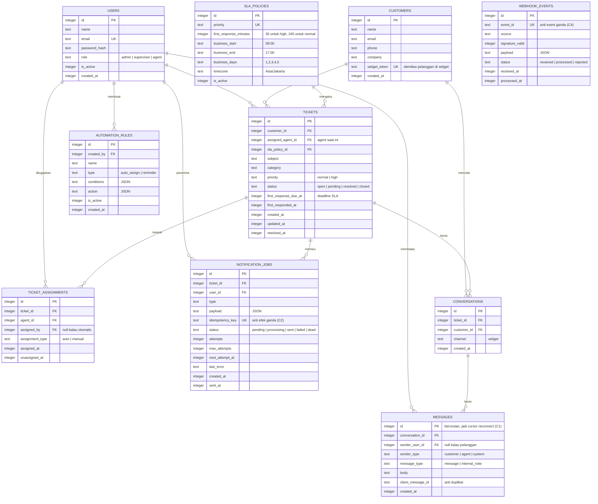

# ERD: Khwarizmi ConnectHub

Database: Cloudflare D1 (SQLite). Semua waktu disimpan dalam UTC; perhitungan jam kerja
SLA dilakukan di zona waktu Asia/Jakarta.

## Diagram

## Keputusan desain

- **Satu ticket punya satu conversation utama.** Pesan baru dari pelanggan yang masih punya tiket
  terbuka ditempelkan ke tiket itu; kalau tidak ada, dibuat tiket baru.
- **Internal notes disimpan di tabel `messages`** dengan `message_type = internal_note`.
  Pelanggan tidak pernah menerima baris bertipe ini.
- **`tickets.assigned_agent_id`** menyimpan penanggung jawab saat ini (cepat untuk filter inbox),
  sedangkan `ticket_assignments` menyimpan riwayat perpindahan.
- **Waktu disimpan sebagai UTC** (integer epoch milidetik).

## Index

| Tabel | Index | Untuk apa |
| --- | --- | --- |
| users | UNIQUE(email) | Login |
| customers | UNIQUE(widget_token) | Mengenali pelanggan widget |
| tickets | (assigned_agent_id, status) | Inbox agent |
| tickets | (status, priority) | Filter tiket |
| tickets | (first_response_due_at) | Tiket telat dan backlog |
| ticket_assignments | (ticket_id), (agent_id) | Riwayat dan beban agent |
| messages | (conversation_id, id) | Ambil pesan setelah ID terakhir (C1) |
| messages | UNIQUE(conversation_id, client_message_id) | Cegah pesan dobel |
| notification_jobs | UNIQUE(idempotency_key) | Cegah efek ganda (C2) |
| notification_jobs | (status, next_attempt_at) | Cari job yang siap dicoba ulang |
| webhook_events | UNIQUE(event_id) | Cegah event diproses dua kali (C4) |

## Hubungan dengan tantangan

| Tantangan | Didukung oleh |
| --- | --- |
| C1 Reconnect | `messages.id` berurutan; client kirim ID terakhir, server balas semua pesan setelahnya |
| C2 Job retry | `idempotency_key`, `status`, `attempts`, `next_attempt_at`, `last_error` |
| C3 SLA engine | `sla_policies`, `tickets.first_response_due_at`, `first_responded_at` |
| C4 Webhook aman | `webhook_events.event_id` unik dan `signature_valid` |
